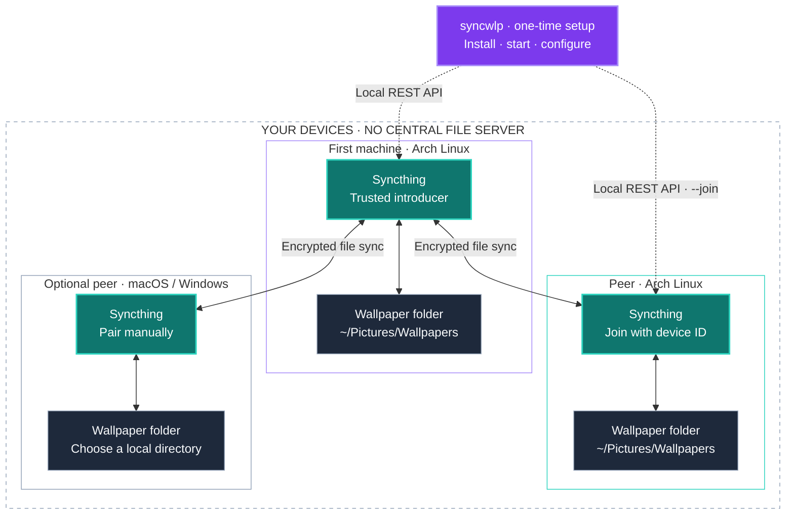

# syncwlp

syncwlp configures Syncthing to sync `~/Pictures/Wallpapers` between devices.

## Architecture



Solid arrows show two-way file sync; dotted arrows show setup only. Syncthing
handles discovery and encrypted transport, directly or through a relay. The first
machine introduces trusted peers; it is not a central file server. Accept each
peer **and share the folder** before syncing. This syncs files, not the desktop's
active wallpaper selection.

## Setup

The installer targets Arch Linux with a systemd user session and uses pacman for missing packages.
Syncthing's local HTTP GUI must be enabled. **No cloning required—leave an existing
Syncthing instance running.**

On the first machine:

```bash
curl -fsSL https://raw.githubusercontent.com/opx0/syncwlp/main/syncwlp-setup.sh | bash
```

Setup prints a ready-to-copy command for each peer, including your device ID.
The command has this form (replace `FIRST_MACHINE_ID`):

```bash
curl -fsSL https://raw.githubusercontent.com/opx0/syncwlp/main/syncwlp-setup.sh | bash -s -- --join FIRST_MACHINE_ID
```

These commands execute the downloaded script. To inspect it first, open
[`syncwlp-setup.sh`](syncwlp-setup.sh). To check an existing setup without changes:

```bash
curl -fsSL https://raw.githubusercontent.com/opx0/syncwlp/main/syncwlp-setup.sh | bash -s -- --check
```

In the first machine's Syncthing UI, accept each peer and share **Wallpapers**
with it. Peers trust the first machine as an introducer. File edits and
deletions sync both ways.

The folder ID defaults to `wallpapers`. To override it, set
`SYNCWLP_FOLDER_ID` to the same value on every machine before setup. The printed
invite command includes the folder ID automatically.

On Windows or macOS, pair the device in Syncthing and accept the shared folder
at your preferred wallpaper directory.

Existing folder settings, device identity, peer trust settings, and wallpaper
watchers are preserved. Missing peers are added only when you use `--join`.

[MIT license](LICENSE)
